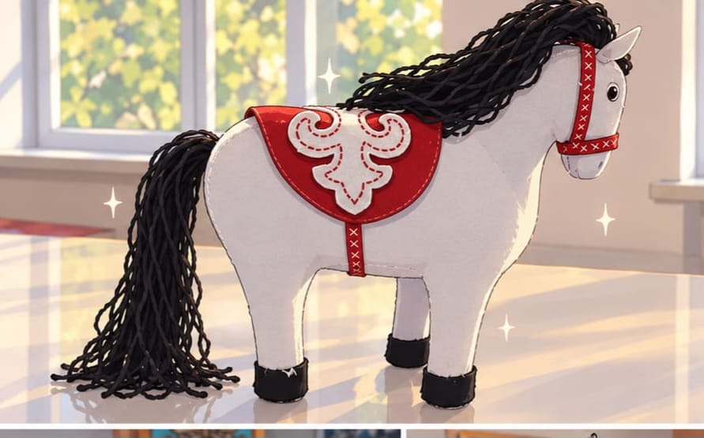
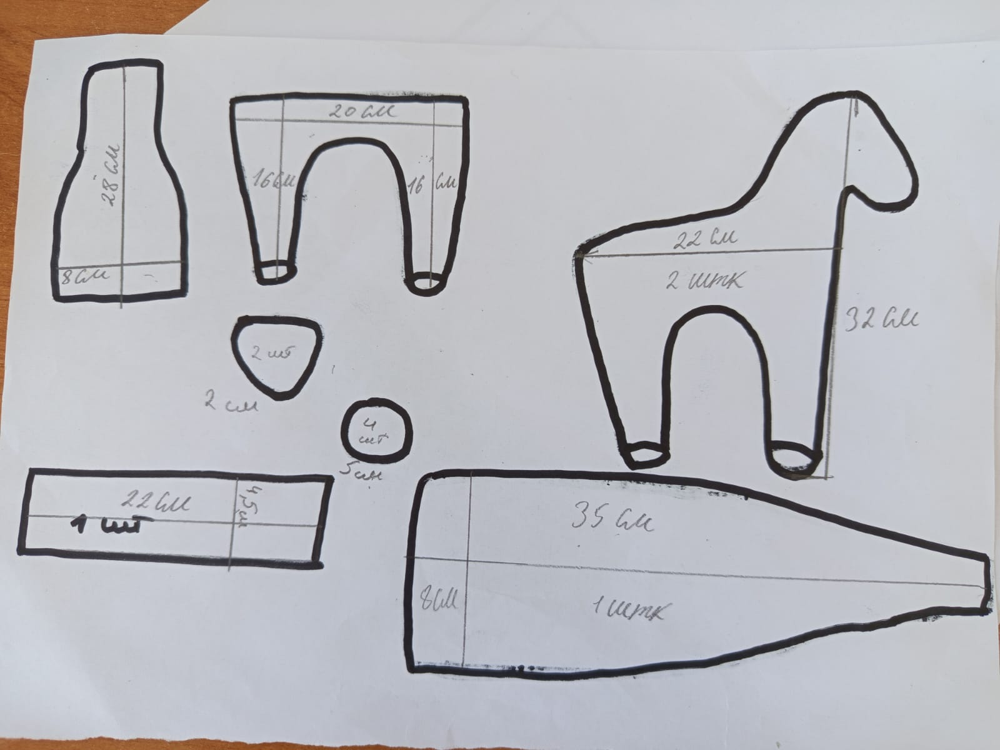

# 🐴 Лошадка из фетра

### Пошаговая инструкция по созданию мягкой игрушки своими руками

<!-- 📸 ШАБЛОН КАРТИНКИ №1: готовая игрушка -->
<!-- Загрузите фото в папку images/ и замените имя файла ниже -->

*Белая лошадка с красной попоной, чёрной гривой и узором «бараньи рога»*

---

## 📑 Содержание

1. [Материалы и инструменты](#-материалы-и-инструменты)
2. [Выкройка](#-выкройка)
3. [Вырезание деталей](#️-вырезание-деталей)
4. [Вышивание деталей](#-вышивание-деталей)
5. [Сборка](#-сборка)
6. [Грива и хвост](#-грива-и-хвост)
7. [Финальные штрихи](#-финальные-штрихи)

---

## 🧵 Материалы и инструменты

| Материал | Для чего |
|---|---|
| ⚪ Белый или светло-серый фетр | Основа: туловище, голова, ноги |
| 🔴 Красный фетр | Попона (седло) |
| ⚪ Белый фетр | Узор «бараньи рога» на попоне |
| ⚫ Чёрный фетр | Копыта |
| ⚫ Чёрная пряжа или шнур | Грива и хвост |
| 🎀 Красная тесьма с крестиками | Уздечка и подпруга |
| 🪡 Нитки мулине: белые, красные, чёрные | Швы и вышивка |
| ☁️ Синтепон или холлофайбер | Наполнитель |

**Инструменты:** бумага, карандаш, линейка, ножницы, иголка, булавки, мел для ткани.

---

## 📐 Выкройка

<!-- 📸 ШАБЛОН КАРТИНКИ №2: выкройка -->
<!-- Загрузите фото выкройки в папку images/ и замените имя файла ниже -->

  

Это чертёж будущей игрушки. Перенесите выкройки на бумагу **в натуральную величину**, соблюдая указанные размеры, и вырежьте шаблоны.

| № | Деталь | Размер | Кол-во |
|:-:|---|---|:-:|
| 1 | Туловище с двумя ногами | 22 × 32 см | 2 шт |
| 2 | Деталь с двумя ногами (вставка между половинками) | ширина 20 см, ноги 16 см | 1 шт ⚠️ |
| 3 | Голова и шея | 28 × 8 см | 1 шт ⚠️ |
| 4 | Длинная боковая вставка | 35 × 9 см | 1 шт ⚠️ |
| 5 | Полоса | 22 × 4,5 см | 1 шт ⚠️ |
| 6 | Уши | 2 см | 2 шт |
| 7 | Круги для копыт | диаметр 5 см | 4 шт |

> [!NOTE]
> ⚠️ Назначение этих деталей определено по форме на чертеже. Сверьтесь со своим чертежом и при необходимости поправьте таблицу.

---

## ✂️ Вырезание деталей

1. **Приколите** бумажные шаблоны булавками к фетру и обведите их мелом или карандашом.
2. **Вырежьте** детали из фетра. Парные детали (например, две половины туловища) вырезайте так, чтобы они совпали по форме.
3. **Сравните** получившиеся детали: сложите их друг с другом и подровняйте края, чтобы они совпадали по размеру и форме.
4. Из **красного фетра** вырежьте попону.
5. Из **белого фетра** вырежьте узор «бараньи рога» и пришейте его на попону.
6. Из **чёрного фетра** вырежьте детали копыт.

> [!TIP]
> Фетр не осыпается, поэтому края можно не подгибать. Но ножницы должны быть острыми, иначе края получатся рваными.

---

## 🪡 Вышивание деталей

Все детали вышиваются **обмёточным швом** (петельным швом).

**Как делать обмёточный шов:**

1. Выведите иглу на лицевую сторону у самого края детали.
2. Сделайте новый вкол на 3–4 мм дальше и проведите иглу под нитку, так чтобы она легла петлёй по краю.
3. Затяните нитку не слишком туго и повторяйте шаги по всей длине края.

**Порядок работы:**

1. Вышейте красными нитками узор на попоне, затем окантовку.
2. Нашейте красную тесьму на голову (уздечка) и на туловище (подпруга).
3. Соедините детали туловища обмёточным швом, оставив небольшое отверстие для набивки.

---

## 🧸 Сборка

1. Сложите две половины туловища лицевой стороной наружу и соедините их вставками.
2. Набейте игрушку наполнителем. Ноги и шею набивайте **плотнее**, чтобы лошадка устойчиво стояла.
3. Зашейте отверстие потайным швом.
4. Пришейте чёрные круги к низу ног, чтобы получились копыта.
5. Пришейте уши.

---

## 🌿 Грива и хвост

1. Нарежьте чёрную пряжу или шнур на пряди: для гривы покороче, для хвоста подлиннее.
2. Сложите каждую прядь пополам и пришейте петлёй вдоль шеи и в основании хвоста.
3. Распустите пряди, чтобы получилась пышная волнистая грива.

---

## ✨ Финальные штрихи

- Сделайте глаз из чёрной бусины или вышейте его чёрными нитками.
- Положите попону на спину лошадки и закрепите подпругу под животом.

**Готово! 🎉 Ваша лошадка может отправляться в путь.**

---

Сделано с ❤️ своими руками

